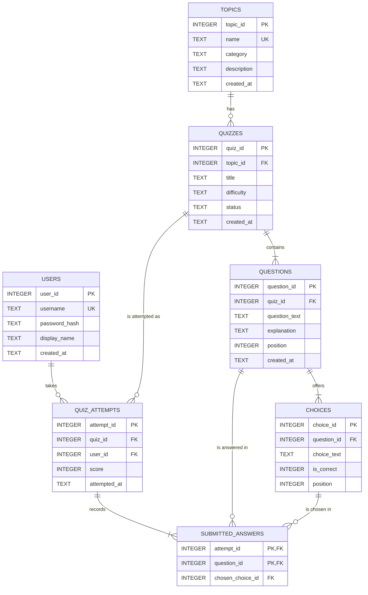

# CodeQuest — Entity Relationship Diagram (ERD)

*Phase P1 deliverable — a draft sketch of the seven tables of
`database/schema.sql`. The diagram is redrawn and finalised in phase P17
against the deployed schema.*

## 1. Diagram (Mermaid)

**Legend (crow's-foot notation).**

| Symbol | Meaning |
|---|---|
| `||` | exactly one (the parent row must exist) |
| `o{` | zero or more (a topic may have no quizzes yet) |
| `|{` | one or more (a stored quiz always has at least one question, and a stored attempt always has at least one answer) |
| `PK` | primary key · `FK` foreign key · `UK` unique (alternate) key |

## 2. Entities and attributes

| Entity | Attributes | Key |
|---|---|---|
| **USERS** | `user_id` INTEGER, `username` TEXT, `password_hash` TEXT, `display_name` TEXT, `created_at` TEXT | `user_id` (PK); `username` unique |
| **TOPICS** | `topic_id` INTEGER, `name` TEXT, `category` TEXT, `description` TEXT, `created_at` TEXT | `topic_id` (PK); `name` unique |
| **QUIZZES** | `quiz_id` INTEGER, `topic_id` INTEGER, `title` TEXT, `difficulty` TEXT, `status` TEXT, `created_at` TEXT | `quiz_id` (PK); `(topic_id, title)` unique |
| **QUESTIONS** | `question_id` INTEGER, `quiz_id` INTEGER, `question_text` TEXT, `explanation` TEXT, `position` INTEGER, `created_at` TEXT | `question_id` (PK); `(quiz_id, position)` unique |
| **CHOICES** | `choice_id` INTEGER, `question_id` INTEGER, `choice_text` TEXT, `is_correct` INTEGER, `position` INTEGER | `choice_id` (PK); `(question_id, choice_text)` unique |
| **QUIZ_ATTEMPTS** | `attempt_id` INTEGER, `quiz_id` INTEGER, `user_id` INTEGER, `score` INTEGER, `attempted_at` TEXT | `attempt_id` (PK) |
| **SUBMITTED_ANSWERS** | `attempt_id` INTEGER, `question_id` INTEGER, `chosen_choice_id` INTEGER | `(attempt_id, question_id)` (composite PK) |

**Column rules that the diagram cannot show:**

* `quizzes.status` — `CHECK (status IN ('Draft', 'Approved'))`. A quiz is born
  `Draft` and becomes `Approved` only after its answer key has been reviewed;
  only `Approved` quizzes are takeable (P9) and only `Draft` quizzes appear in
  the review screen (P13).
* `quizzes.difficulty` — `CHECK (difficulty IN ('Easy', 'Medium', 'Hard'))`.
* `topics.category` — `CHECK (category IN ('Programming', 'Cybersecurity'))`.
* `choices.is_correct` — `CHECK (is_correct IN (0, 1))`; exactly one option of
  each question has the value `1`.
* `questions.position`, `choices.position` — `CHECK (position >= 1)`; the order
  in which the quiz player shows the questions and the options.
* `quiz_attempts.score` — `CHECK (score >= 0)`; the number of correct answers.
  The number of answered questions is not stored, it is counted from
  `submitted_answers` (see `docs/normalization.md`, section 7.3).

## 3. Relationships and cardinality

| From (child) | To (parent) | Cardinality | Meaning |
|---|---|---|---|
| `quizzes.topic_id` | `topics.topic_id` | **many-to-one** (a topic has 0..n quizzes, every quiz has exactly one topic) | every quiz is filed under exactly one subject |
| `questions.quiz_id` | `quizzes.quiz_id` | **many-to-one** (a quiz has 1..n questions, every question belongs to exactly one quiz) | the questions of a quiz |
| `choices.question_id` | `questions.question_id` | **many-to-one** (a question has 1..n options, every option belongs to exactly one question) | the four options of a question; one of them carries the answer key |
| `quiz_attempts.quiz_id` | `quizzes.quiz_id` | **many-to-one** (a quiz has 0..n attempts) | the same quiz can be taken again and again |
| `quiz_attempts.user_id` | `users.user_id` | **many-to-one** (a user has 0..n attempts) | who took the quiz |
| `submitted_answers.attempt_id` | `quiz_attempts.attempt_id` | **many-to-one** (an attempt has 1..n answers) | the answers of one run |
| `submitted_answers.question_id` | `questions.question_id` | **many-to-one** (a question is answered in 0..n answers) | which question was answered |
| `submitted_answers.chosen_choice_id` | `choices.choice_id` | **many-to-one** (an option is chosen in 0..n answers) | which option was picked |
| `submitted_answers.(question_id, chosen_choice_id)` | `choices.(question_id, choice_id)` | **composite many-to-one** | the picked option must belong to the answered question |

The last row is a **composite foreign key**. Mermaid's ER syntax cannot draw a
relationship on two column pairs, so it is not a line in the diagram — it is
listed here and in `docs/normalization.md` (section 9) so that the diagram and
the schema stay in step.

## 4. Delete rules

Each relationship carries an `ON DELETE` action, chosen so that a delete either
removes the rows that would be meaningless without their parent, or is
blocked:

| Relationship | ON DELETE | What happens in the UI |
|---|---|---|
| `quizzes` → `topics` | `RESTRICT` | The topic cannot be deleted while quizzes use it — the management screen shows a friendly message (P8). |
| `questions` → `quizzes` | `CASCADE` | Deleting a quiz that was never attempted removes its questions and their options as well. |
| `choices` → `questions` | `CASCADE` | Deleting a question removes its options. |
| `quiz_attempts` → `quizzes` | `RESTRICT` | A quiz that was already taken cannot be deleted — the attempt history protects it. |
| `quiz_attempts` → `users` | `RESTRICT` | A user with attempts cannot be deleted. |
| `submitted_answers` → `quiz_attempts` | `CASCADE` | Deleting an attempt removes its answer rows. |
| `submitted_answers` → `questions` | `RESTRICT` | A question that was answered cannot be deleted. |
| `submitted_answers` → `choices` | `RESTRICT` | An option that was picked cannot be deleted. |
| `submitted_answers` → `choices` (composite) | `RESTRICT` | Same rule, applied through the composite key. |

> **SQLite reminder.** These rules are only enforced when the connection runs
> `PRAGMA foreign_keys = ON` (off by default — <https://sqlite.org/foreignkeys.html>
> §2). The application has to switch it on for every connection it opens
> (phase P4, `Data/Db.cs`).

## 5. Notes on reading the diagram

* The diagram shows the **structure**, the data is in
  `database/schema.sql` (the source of truth) and the sample rows are in
  `database/seed.sql`.
* The content chain (`topics → quizzes → questions → choices`) holds the
  material; the history chain (`users → quiz_attempts → submitted_answers`)
  holds what the student did with it. `submitted_answers` is the only table
  that touches both chains.
* `submitted_answers` deliberately has **no** `is_correct` column: the answer
  key belongs to `choices`, and correctness is derived by joining the two
  tables. The same applies to `quiz_attempts`, which stores the number of
  correct answers but not the percentage. Both decisions are explained in
  `docs/normalization.md` (sections 7.2 and 7.3).
* This is the **P1 draft**. Phase P17 redraws the diagram so that it matches
  the deployed schema column by column.
